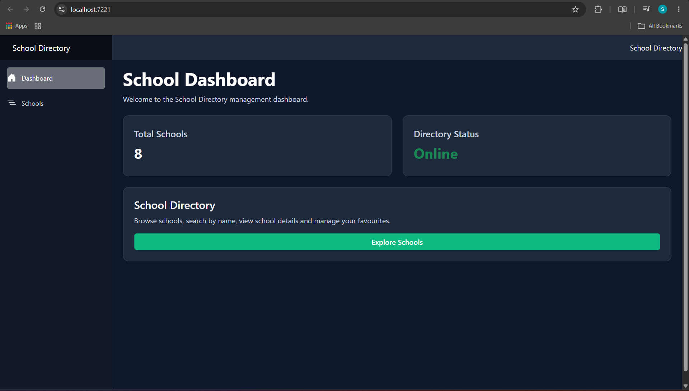
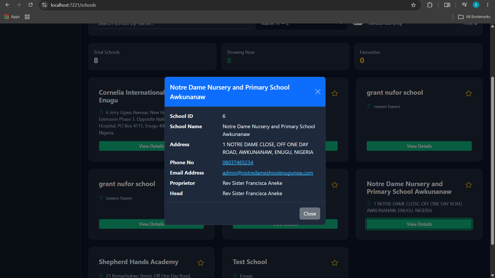
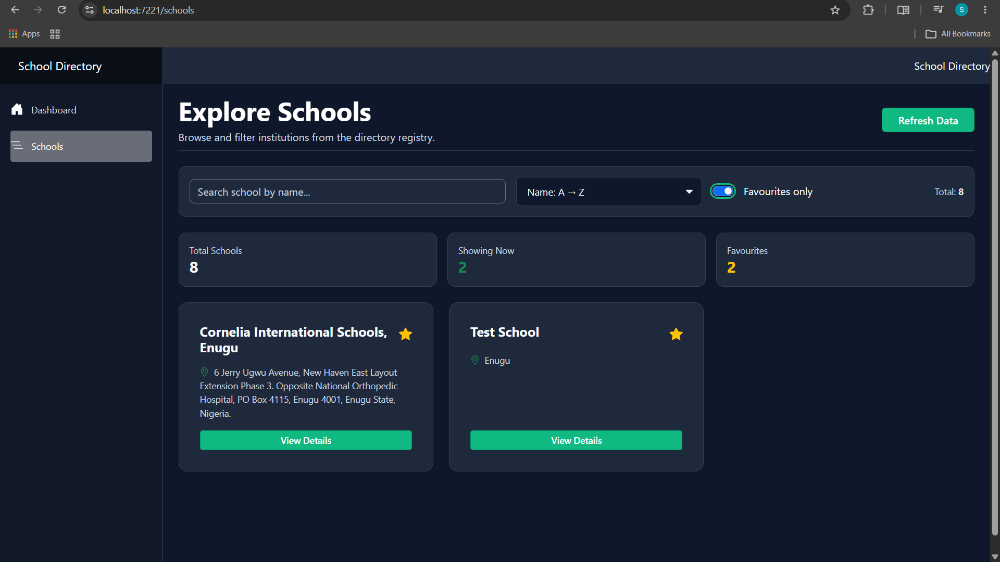

# School Directory Dashboard

**Student ID:** 76239  

**Project:** SchoolDirectoryApp_76239

## Overview

School Directory Dashboard is a Blazor Web Application that retrieves school information from the Edutots School API and displays it in a simple, interactive interface.

Users can browse schools, search by school name, sort the list, add schools to favourites, and view detailed information about individual schools. The application also includes a dashboard showing the total number of schools and the API connection status.

## 🚀 Features

\- Retrieves school information from the Edutots School API using `HttpClient`.

\- Displays schools in a card layout with their names and addresses.

\- Live search to filter schools by name.

\- Sort schools alphabetically (A–Z and Z–A).

\- View full school information by clicking **View Details**.

\- Add or remove schools from favourites using the star button.

\- Filter the school list to show favourites only.

\- Refresh button to reload school data.

\- Loading indicator while retrieving data.

\- Error message when the API request fails.

\- Dashboard showing total schools and directory connection status.

\- School list statistics showing total schools, displayed schools and favourites.

\- Reusable Blazor `SchoolCard` component using parameters and `EventCallback`.

## 🌐 API Endpoint

The application uses the Edutots School API:

```http

GET https://edutots.net/api/school

```

The API response is deserialized into the `School` model containing these seven fields:

| Field | Description |

|---|---|

| `SchoolId` | School identification number |

| `SchoolName` | Name of the school |

| `Address` | School address |

| `PhoneNo` | Contact phone number |

| `EmailAddress` | Email address |

| `ProprietorFullName` | Name of the proprietor |

| `HeadFullName` | Name of the head of the school |

The school cards display basic information, while the details popup displays all seven fields.

## 🛠 Technologies Used

\- C# and .NET 10

\- Blazor Web App (Interactive Server)

\- HttpClient

\- JSON Deserialization

\- Bootstrap

\- HTML and CSS

\- Visual Studio

\- Git and GitHub

## 📂 Project Structure

```text

SchoolDirectoryApp_76239/

│

├── Components/

│   ├── Pages/

│   │   ├── Home.razor

│   │   └── School.razor

│   │

│   ├── SchoolCard.razor

│   ├── SchoolDetail.razor

│   └── Layout/

│

├── Models/

│   └── School.cs

│

├── Services/

│   ├── SchoolService.cs

│   └── FavouriteService.cs

│

├── Screenshots/

│

├── wwwroot/

│   └── app.css

│

└── Program.cs

```

### Main Files

\- **School.cs** — Defines the school model and its properties.

\- **SchoolService.cs** — Retrieves school data from the API.

\- **SchoolCard.razor** — Reusable component for displaying individual schools.

\- **SchoolDetail.razor** — Displays complete information about a selected school.

\- **School.razor** — Displays the school list, search, sorting and favourites.

\- **Home.razor** — Displays the main dashboard.

\- **FavouriteService.cs** — Manages favourite school IDs.

## 🔧 Installation and Usage

### Requirements

\- .NET 10 SDK

\- Visual Studio with ASP.NET and web development support, or another compatible editor

\- Internet connection to access the Edutots API

### Running the Application

1. Clone the repository:

```bash

git clone https://github.com/Syed-Muneeb25/SchoolDirectoryApp_76239.git

```

2. Open the project directory:

```bash

cd SchoolDirectoryApp_76239/SchoolDirectoryApp_76239

```

3. Run the application:

```bash

dotnet run

```

4. Open the localhost address displayed in the terminal.

Alternatively, open `SchoolDirectoryApp_76239.slnx` in Visual Studio and run the project.

## 📸 Screenshots

### 1. Dashboard

The homepage displays the total number of schools and the directory connection status.



### 2. School List

Schools are displayed as cards with their names, addresses, favourite buttons and View Details buttons.


### 3. School Details

Clicking View Details opens a popup showing all seven school information fields.



### 4. Search and Sorting

Users can search for schools by name and change the alphabetical sorting order.


### 5. Favourites

Users can mark schools as favourites and filter the list to display only their selected schools.



### 6. Loading State

A loading indicator appears while the application is retrieving school information.


### 7. Error State

An error message is displayed when the API request fails.


## ✅ Conclusion

This project demonstrates the use of Blazor components, API integration, data binding, EventCallback, searching, sorting and basic error handling.

The goal is to provide a simple School Directory Dashboard that allows users to find schools and view their information easily.

\---

**GitHub Repository:** https://github.com/Syed-Muneeb25/SchoolDirectoryApp_76239

